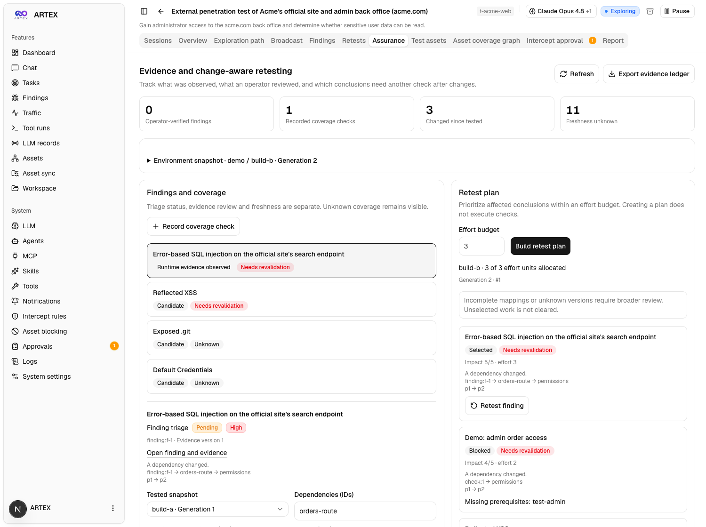

# Task assurance and change-aware retesting

The **Assurance** tab on a task connects versioned target observations, existing
findings, explicit coverage checks, evidence reviews and saved retest plans.
It answers three separate questions:

1. What supports a finding or a previous “no issue observed” conclusion?
2. Does that support still apply after the target, constraints or evidence changed?
3. Which checks should be repeated, which are blocked, and what happened when they ran?

The existing finding remediation status and rough asset-coverage graph remain
separate. A finding marked `confirmed` by the exploration engine is not
automatically independently verified in this workspace.



*Local synthetic mock data; the screenshot does not represent a real assessment.*

## Walk through a task

1. Open a task and choose **Assurance**. Existing findings appear automatically.
   Findings without a declared mapping remain unknown; an empty list is not a
   clean security assessment.
2. **Save a target snapshot.** Enter the environment, application revision,
   dependency IDs/versions and their relationships. For example, `orders-route`
   depends on `permissions`. List available prerequisite identifiers such as
   `test-user`; never enter their passwords or tokens.
3. **Map a finding.** Select its tested baseline generation, dependencies,
   priority, effort estimate and prerequisites. Mark the mapping complete only
   when its relationships are established for the compared snapshots.
4. **Record a coverage check.** Enter the surface, identity, workflow and risk
   category. Record `observed_not_vulnerable`, `inconclusive` or `blocked`, explain
   what was checked and optionally cite task evidence. These are explicit
   operator-reported observations. Absence of a finding never creates a negative
   coverage record automatically.
5. **Review evidence.** A finding can receive an explicit operator verification
   or rejection with reviewer name, rationale and references. Verification requires
   evidence bound to the finding, plus the displayed evidence hash/version and
   current generation. Concurrent changes cause a conflict instead of silently
   accepting a review of different evidence.
6. **Record a change and build a plan.** Save the next target version, then set
   an effort budget. Each saved plan explains stale/unknown conclusions and shows
   selected, blocked, deferred and unchanged work. An updated shared permission
   policy can invalidate both a finding and a negative coverage check.
7. **Run selected finding checks.** Confirm an individual selected finding to
   start ARTEX's existing retest conversation. This uses the configured retester
   agent and its normal tool/interception flow. Required prerequisites must be
   declared available and the plan must still match the current target. Negative
   coverage checks remain manual work; they are not sent to a finding-only agent.
8. **Inspect results or export.** Retest status and historical/stale outcomes remain
   visible. Export downloads a versioned JSON record of the workspace, including
   all saved snapshots, reviews, mapping history, plans with reproducible inputs,
   and planned retest outcomes.

Interface labels are translated in all five supported locales. Uncatalogued
backend diagnostic details remain English.

No model is needed to manage snapshots, coverage, reviews or plans. Actually
running a retest uses ARTEX's existing model configuration and incurs its normal
execution cost. Effort units are scheduling estimates, not a dollar/token cap.

## Keep three dimensions separate

| Dimension | Meaning |
| --- | --- |
| Remediation | Existing finding state such as pending, fixed or ignored. |
| Assurance | Source of support: candidate, captured runtime activity, agent-reported retest, or explicit operator review. |
| Freshness | Whether the declared dependencies/evidence still match: supported for snapshot, stale or unknown. |

Assurance labels are deliberately specific:

- `candidate`: a reported finding without stronger recorded support.
- `runtime_observed`: the finding has bound traffic evidence. Capturing a request
  does not establish exploitability or complete testing.
- `retest_reported`: a completed, nonstale retest reported reproduced/fixed and
  advanced the tested baseline. This is an agent-reported result, not independent
  human verification.
- `operator_verified` / `rejected`: a recorded operator decision with explicit
  provenance and rationale. The reviewer name is an operator-supplied label under
  ARTEX's existing global-admin authentication, not a separate reviewer identity.

Evidence references distinguish captured `traffic_snapshot` artifacts from a
versioned `finding_document`. This also supports non-HTTP findings. Referencing a
document does not turn its prose into runtime evidence.

Reviews remain in history when their support becomes stale. A stale review cannot
silently retain current verified status. Incomplete dependency mappings remain
unknown even after a retest, and failed/stopped/inconclusive runs never restore
support. Budget selection never hides unresolved work.

## What is observed automatically

The server maintains reserved `artex:` dependency nodes for finding evidence,
task constraints and the declared dependency graph. It fingerprints evidence
content, bound evidence versions and task context. Reading the workspace after a
relevant runtime change records a new observation generation without rewriting
the operator's application revision. Clients cannot supply reserved nodes.

Application/code/configuration dependencies still require an operator-supplied
map. There is no automatic source-code dependency discovery. Versions must cover
relevant behavior and changed relationships; use a graph covering both snapshots
and mark uncertain mappings incomplete. Stable versions in an inaccurate map do
not establish that unrelated behavior is safe.

Operator mapping/prerequisite edits invalidate previously saved plans. Accepting
one successful item advances that conclusion's tested baseline without changing
the target identity or invalidating the other items from the same plan.

## Dispatch and completion guarantees

- Plans and their inputs are immutable database records scoped to one task.
- Dispatch validates task ownership, the saved selected item, current generation
  and fingerprint inside the conversation-creation transaction.
- One plan/conclusion pair creates at most one retest. A repeat request for a
  still-current plan returns that run, including after completion. A manual or
  different-plan active run cannot be rebound to the new plan.
- Startup checks freshness again. A change between dispatch and startup stops
  the pending run. Task attribution is retained in conversation tool/evidence
  records and interception context.
- Finalization compares the tested snapshot in the same transaction as result
  publication. A changed target/evidence/constraint snapshot keeps the result
  historical and prevents it from marking the current finding fixed.
- A successful nonstale reproduced/fixed result advances the recorded tested
  baseline. Retest evidence and original finding evidence remain distinct.
- Stopped, failed, missing-verdict and inconclusive results remain unresolved.
  The existing conversation/restart recovery paths continue to seal interrupted
  work.

These checks bind execution to recorded task context. They do not add a network
sandbox or a new authorization mechanism. Existing action controls and the task's
authorized scope still govern actual execution.

## API and storage

All endpoints are under the existing authenticated `/api/tasks/{id}/assurance`
namespace:

| Method and suffix | Operation |
| --- | --- |
| `GET /` | Current workspace and bounded recent history. |
| `POST /snapshots` | Append an immutable snapshot using `expected_generation`. |
| `PUT /conclusions/{cid}` | Update an explicit mapping and append its history. |
| `POST /coverage` | Add an explicit coverage observation. |
| `POST /conclusions/{cid}/reviews` | Record a scoped, evidence-bound operator review. |
| `POST /plans` | Save a budgeted plan against the expected generation. |
| `GET /plans/{pid}` | Load the saved plan and its comparison inputs. |
| `POST /plans/{pid}/items/{cid}/retest` | Start/retrieve a selected finding's retest. |
| `GET /export` | Export full recorded history and plan inputs. |

Errors use 400 for invalid input, 404 for missing/cross-task records and 409 for
stale versions or incompatible active work. Request bodies are limited to 1 MiB
and reject unknown fields/trailing documents. Workspaces support up to 2,000
conclusions and 1,000 declared dependency nodes; excessive input is rejected
instead of producing partial assurance. Interactive history is bounded and marks
truncation explicitly; export includes the full retained record.

The additive PostgreSQL tables are `assurance_snapshots`,
`assurance_conclusions`, `assurance_conclusion_history`,
`assurance_coverage_checks`, `assurance_reviews` and `assurance_plans`.
Existing `finding_retests` gains plan/snapshot binding metadata. Migrations are
idempotent and preserve finding IDs, triage and internal reasoning prompts.

Task archive format v4 preserves assurance snapshots, reviews, mappings, coverage,
plans and terminal retest outcomes. Active retests prevent archival until they
finish or stop. A final comparison before compaction refuses to discard history
that changed after capture. Restore retains existing IDs and immutable comparison
inputs; a deleted conversation remains a historical result without a session link.
Older archive formats remain readable. Task deletion remains deletion; export
records before intentionally deleting them.

The export's `complete: false` prevents mistaking a ledger of explicitly recorded
checks for exhaustive security coverage. `task_status`, per-conclusion freshness,
coverage outcomes and plan/retest states describe what actually happened.

The [offline planner](change-aware-retesting.md) remains available through
`artex -retest-plan` for integrations that already have their own versioned input.

## Verification and limits

Regression tests use synthetic data, fake model providers and isolated PostgreSQL.
They exercise real database transactions and authenticated HTTP routing, including
cross-task references, compare-and-swap conflicts, evidence changes during runs,
duplicate dispatch, task attribution, baseline acceptance, multi-item plans,
archive/restore roundtrips and complete exports. Frontend tests cover forms,
failure/retry, task changes, translations and dispatch state.

```bash
go test ./retestplan ./db ./server ./agent -count=1
cd web
npm test -- --run
npm run check:i18n
npm run build:static
```

The DB tests require an isolated `ARTEX_PG_DSN`; do not point them at a working
installation. Independent package databases avoid the upstream test harness's
shared-state assumptions. No real-target detection benchmark or model comparison
is claimed. This contribution covers the assurance/coverage/change-retest portions
of [issue #47](https://github.com/jiwoochris/artex-global/issues/47); stuck-worker
supervision, monetary budget enforcement and distributed runners are separate work.
